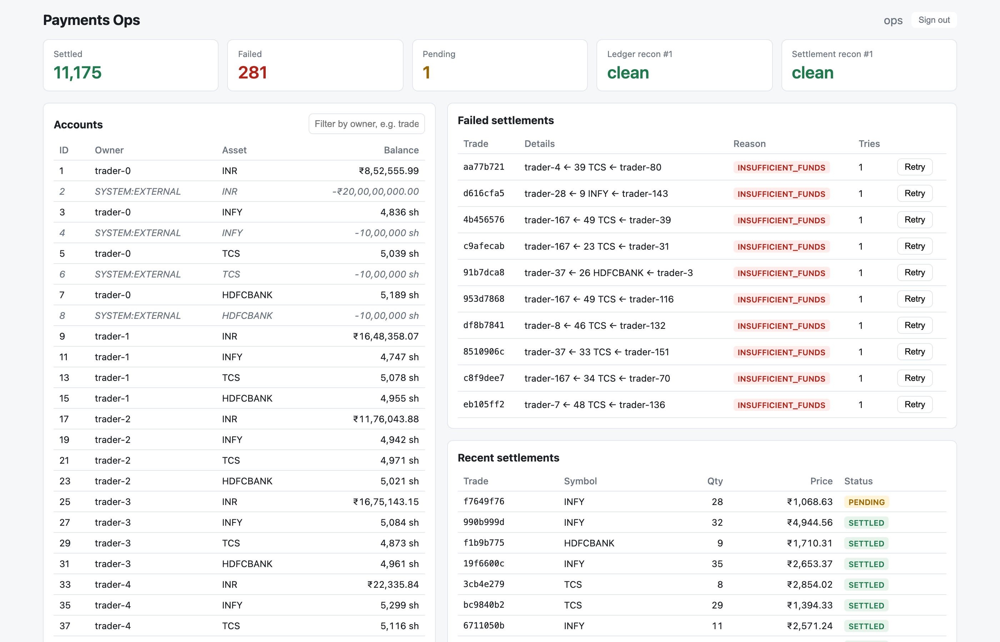
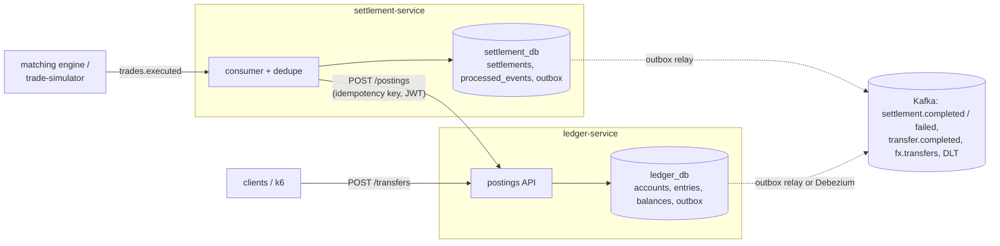
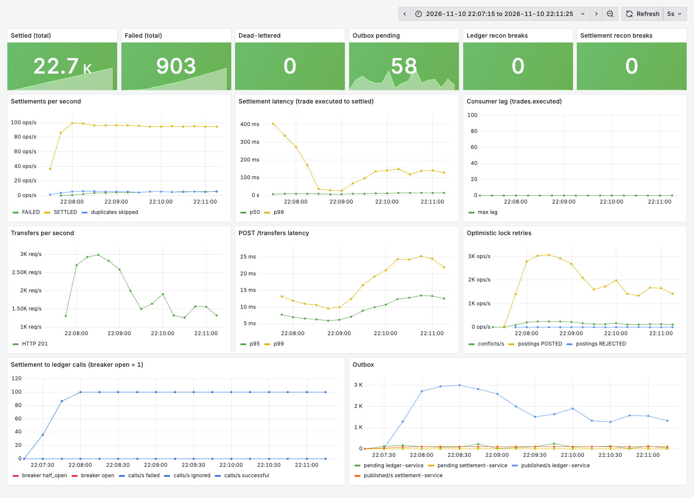

# payments-service

Trade settlement and payments on a double-entry ledger. Java 21, Spring Boot 3.5, PostgreSQL, Kafka.

A matching engine decides who traded with whom. This system does what happens next: it reads each
executed trade from Kafka and, in one database transaction, moves the buyer's cash to the seller and
the seller's shares to the buyer (delivery versus payment). Either all four movements happen or none
do, and each trade is applied exactly once even if Kafka delivers it twice or a service dies halfway.
There is also a plain money-transfer API and cross-currency transfers.



## What's in it



- **ledger-service**: accounts, append-only ledger entries, balances, `POST /transfers`, internal `POST /postings`.
- **settlement-service**: consumes `trades.executed`, settles through the ledger, tracks SETTLED/FAILED, FX transfers.
- **trade-simulator**: seeds traders and publishes trades the way the engine does (JSON on `trades.executed`, keyed by trade id).
- **dashboard**: React page for ops (balances, recent and failed settlements with a retry button, reconciliation status).
- Keycloak for JWTs, Prometheus + Grafana + Jaeger for metrics and traces, a Helm chart for Kubernetes.

Money is always a `long` in minor units (paise, cents), shares are whole units. No `double` anywhere.

## Run it

Needs Docker. Everything starts with one command:

```bash
docker compose up -d --build --wait
```

Then publish some trades and check the books:

```bash
scripts/e2e.sh 1000
```

| | |
|---|---|
| Dashboard | http://localhost:3000 (login `ops` / `ops`) |
| Grafana | http://localhost:3001 |
| Jaeger | http://localhost:16686 |
| Swagger | http://localhost:8081/swagger-ui.html, http://localhost:8082/swagger-ui.html |

To call the APIs yourself, get a token from Keycloak:

```bash
TOKEN=$(curl -s -d grant_type=client_credentials -d client_id=ops-cli -d client_secret=ops-secret \
  localhost:8180/realms/payments/protocol/openid-connect/token | jq -r .access_token)
curl -H "Authorization: Bearer $TOKEN" -H "Idempotency-Key: t-1" -H "Content-Type: application/json" \
  localhost:8081/transfers -d '{"fromAccountId": 1, "toAccountId": 9, "amount": 5000}'
```

Tests (Testcontainers starts real Postgres and Kafka, so Docker must be running):

```bash
./mvnw verify
```

Other scripts: `scripts/transfers.k6.js` (load test), `scripts/chaos.sh` (kill things mid-settlement),
`scripts/outbox-latency.sh`, `scripts/kind-deploy.sh` + `scripts/k8s-rollout-test.sh` (Kubernetes).

## How it stays correct

- **Double entry, checked by the database.** Every posting must have equal debits and credits per asset.
  The service checks it, and a deferred constraint trigger checks it again at commit, so an unbalanced
  transaction can't be committed even by a bug or a hand-written SQL statement. Entries can't be updated
  or deleted (trigger). Money from outside comes from a system account that's allowed to go negative,
  so every asset always sums to zero across the ledger.
- **Idempotency.** `transactions.idempotency_key` is a unique column. A repeat with the same body returns
  the stored result (`Idempotent-Replayed: true`); the same key with a different body is a 409.
  Rejections are stored too, so a retried request that was refused stays refused.
- **Exactly-once settlement on at-least-once Kafka.** The consumer skips trade ids it has finished. The
  ledger call uses `trade-<id>-<attempt>` as its key, so if the service dies after the ledger committed
  but before it recorded SETTLED, the redelivered trade gets the original result back instead of
  posting again.
- **Transactional outbox.** Events are written in the same DB transaction as the change and published
  afterwards by a relay (`FOR UPDATE SKIP LOCKED`, so several instances can run it). A crash after
  commit just means the event goes out on the next poll. Debezium CDC is available as an alternative.
- **Concurrency.** Balances carry a version. A posting reads, checks funds, and updates with
  `where version = ?`, retrying with jittered backoff on conflict. Rows are always touched in account-id
  order, so there are no deadlocks. `LEDGER_LOCKING=PESSIMISTIC` switches to `SELECT ... FOR UPDATE`
  (see the numbers below for when that wins).
- **Failures.** Resilience4j retry and circuit breaker on settlement → ledger. Bad messages go straight
  to `trades.executed.DLT`; transient failures are retried with backoff and then dead-lettered. A
  sweeper re-drives trades left PENDING (by a crash or a long ledger outage), and operators can retry
  FAILED trades from the API or dashboard.
- **Reconciliation.** Nightly Spring Batch jobs. The ledger job checks that every transaction balances,
  every balance equals the sum of its entries, and every asset nets to zero. The settlement job checks
  each settlement against what the ledger booked under its key. Breaks go to `recon_mismatches` and a
  metric.
- **FX transfers** run as a saga: debit the customer's source currency to the FX desk, then credit the
  recipient from the desk in the target currency. If the second leg is rejected, the first is refunded
  (REVERSAL). Each step has a fixed key and saga state is stored between steps, so a crash anywhere is
  fixed by resuming.

## Numbers

All measured on my laptop: Apple M4 (10 cores, 24 GB), Docker Desktop with a 12 GB VM. The whole
stack (both services, two Postgres, Kafka, Keycloak, monitoring) runs in that VM, and k6 runs on the
host. Results moved a lot between identical runs, so I show ranges.

**Transfers** (`k6`, 50 virtual users, 60 s, random pairs among 200 accounts, 10% trace sampling):

| Locking | Runs | Transfers/s | p95 | p99 | Errors |
|---|---|---|---|---|---|
| optimistic (default) | 5 | 1,626 – 2,414 | 45 – 66 ms | 68 – 104 ms | 0 |
| pessimistic | 2 | 1,855 – 2,258 | 44 – 56 ms | 65 – 84 ms | 0 |

**One hot account** (same test, every transfer debits the same account):

| Locking | Runs | Transfers/s | p99 | Errors |
|---|---|---|---|---|
| optimistic | 2 | 515 – 542 | 751 – 763 ms | 0.28 – 0.29% (gave up after 40 retries, HTTP 503) |
| pessimistic | 2 | 781 – 928 | 206 – 271 ms | 0 |

Optimistic locking costs nothing when accounts rarely collide, but under real contention the retries
cost more than waiting on a row lock. The default stays optimistic, and the switch is there for hot accounts.

**Settlement** (10,000 trades published as fast as possible, time from first to last settlement):

| Setup | Settled/s |
|---|---|
| 20 traders, optimistic, 3 or 12 partitions (5 runs) | 335 – 476 |
| 20 traders, pessimistic (1 run) | 413 |
| 200 traders, optimistic / pessimistic (1 run each) | 408 / 461 |

More partitions didn't help. Each trade is one synchronous HTTP call to the ledger (~15 ms of DB work
plus ~8 ms of HTTP/JWT overhead), and 20 traders means every trade hits one of 20 hot cash accounts.
Batching postings per poll would be the next step.

**Outbox latency** (transaction time in Postgres to broker append time in Kafka, ~30k events per run, 2 runs each):

| Publisher | p50 | p99 |
|---|---|---|
| polling relay, 100 ms interval (default) | 58 – 59 ms | 115 ms |
| polling relay, 10 ms interval | 9 – 11 ms | 20 – 32 ms |
| Debezium, default settings | 350 – 390 ms | 910 – 952 ms |
| Debezium, `poll.interval.ms=10` | 14 ms | 24 – 25 ms |

At this load, a fast poller is as quick as CDC. What Debezium buys is no polling queries against the
database and no `published_at` writes. What it costs is Kafka Connect to run and a replication slot,
which keeps WAL around if the connector stops.

**Chaos** (`scripts/chaos.sh`, 2 runs): 6,000 trades (about 5% sent twice) plus k6 transfers, while
SIGKILLing settlement-service twice and ledger-service, Kafka and the ledger's Postgres once each. Both
runs: every trade ended SETTLED or FAILED with none pending, the number of SETTLED trades equalled the
number of posted ledger transactions exactly, both outboxes drained, all ledger checks passed, and both
reconciliation jobs found 0 mismatches. 12–17% of k6 transfers failed, all of them while the ledger or
its database was down.

**Rolling restart on Kubernetes** (kind, 2 replicas each, k6 inside the cluster at 20 VUs while
`kubectl rollout restart deployment/ledger-service`): 0 failed out of 331,189 and 0 out of 144,012 transfers.

**Tests:** 50 tests (Testcontainers with real Postgres and Kafka, WireMock for cross-service calls, a
jqwik property test running 200 random sequences of transfers, trades and replays). `./mvnw verify` takes about 40 s.

## Trade-offs and limits

- Settlement calls the ledger synchronously per trade, which caps throughput (above). It keeps the
  ledger as the only place balances change, which I wanted more.
- Consumer retries are blocking, so a ledger outage pauses the partition for up to ~25 s before the
  trade is dead-lettered. The sweeper finishes it later. Non-blocking retry topics would avoid the pause.
- Reconciliation scans whole tables. Fine here; at bank volumes it would need to be incremental.
- Settlement reconciliation can't prove every trade the engine executed actually arrived. That needs
  the engine's own trade log to compare against.
- With Debezium on, outbox rows are never marked published or cleaned up, so the `outbox_pending` gauge means nothing.
- FX rates are a static table, and the FX desk has to be funded by hand.
- Keycloak runs in dev mode and secrets in `docker-compose.yml` and `values.yaml` are dev values.
  The Helm chart's `infra` (Postgres, Kafka, Keycloak as single pods, no persistence) is for kind only,
  and the services restart a few times on first boot until Kafka and Postgres are up.
- Transfers check scopes, not ownership: any caller with `ledger.write` can move any account's money.

## Connecting a matching engine

Publish JSON to `trades.executed`, keyed by trade id:

```json
{"tradeId": "T-1", "symbol": "INFY", "price": 152050, "quantity": 10,
 "buyerId": "trader-1", "sellerId": "trader-2", "executedAt": "2026-11-10T10:15:30Z"}
```

`price` is paise per share. Buyer and seller ids are ledger owner ids; cash comes from their `INR`
account and shares from their account for that symbol (a buyer's holding account is opened on first credit).

## Layout

```
common/              shared event type, outbox writer and relay
ledger-service/      accounts, postings, transfers, reconciliation
settlement-service/  trade consumer, settlement, FX saga, reconciliation
trade-simulator/     stand-in for the matching engine
dashboard/           React ops page
helm/payments/       Kubernetes chart
keycloak/            realm with clients and scopes
monitoring/          Prometheus config and Grafana dashboard
debezium/            CDC connector config
scripts/             e2e, chaos, load and latency scripts
```

## Grafana



Steady load on a fresh stack: 100 trades/s from the simulator across 200 traders, plus k6 transfers
at 10 virtual users, for about 4 minutes. Consumer lag stays at 0 and the circuit breaker never opens.
The higher settlement p99 in the first minute is JVM warm-up. "Outbox pending" counts events waiting
for the next 100 ms poll.
